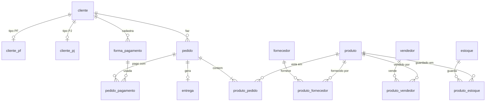

# E-commerce: projeto lógico

Modelo relacional do e-commerce, mapeado a partir do [modelo conceitual refinado](https://github.com/allanvjcavalcanti/ecommerce-modelo-conceitual). Inclui o script de criação, dados de teste e consultas.

Testado em MariaDB 10.11; deve rodar em MySQL 8.0.16 ou superior (precisa de suporte a `CHECK`).

## Arquivos

- `01_schema.sql`: banco, tabelas, chaves, constraints e duas views
- `02_dados.sql`: dados de teste
- `03_queries.sql`: 13 consultas

```bash
mysql -u root -p < 01_schema.sql
mysql -u root -p < 02_dados.sql
mysql -u root -p < 03_queries.sql
```

## Modelo



## Decisões de mapeamento

**Cliente PF ou PJ.** A especialização virou uma tabela pai (`cliente`) e uma tabela por subtipo. Para garantir que a conta não seja PF e PJ ao mesmo tempo sem usar trigger, a tabela pai guarda o `tipo` e tem `unique (id_cliente, tipo)`. As filhas têm o `tipo` fixo (`check (tipo = 'PF')` ou `'PJ'`) e a chave estrangeira é composta por `(id_cliente, tipo)`. Assim o mesmo id nunca entra nas duas. Testei inserir um cliente PF também em `cliente_pj` e o banco recusa.

**Pagamento.** `forma_pagamento` guarda as formas que o cliente cadastrou (só os 4 últimos dígitos do cartão). `pedido_pagamento` registra como cada pedido foi pago, então um pedido pode ser dividido entre mais de uma forma.

**Entrega.** Relação 1:1 com o pedido, com `status` e `codigo_rastreio`. O código é nulo até o envio e pedidos cancelados não têm entrega.

**Views.** `vw_cliente` junta nome e documento de PF e PJ, e `vw_pedido_total` calcula subtotal e total do pedido. Isso evita repetir o mesmo `coalesce` com dois `left join` em cada consulta.

Os relacionamentos N:M viraram tabelas associativas com chave composta, e o vendedor aceita CPF ou CNPJ.

## Perguntas e consultas

O desafio sugeria algumas perguntas. Estas são as consultas que respondem a cada uma, na ordem do arquivo `03_queries.sql`:

- Quantos pedidos cada cliente fez? É a 5ª consulta, e a 6ª filtra quem tem mais de um.
- Algum vendedor também é fornecedor? 8ª consulta, comparando pelo CNPJ.
- Relação de produtos, fornecedores e estoques? 9ª consulta.
- Relação de nomes de fornecedores e produtos? 10ª consulta.

As demais cobrem `where`, atributos derivados (idade, total do pedido), `order by`, `having` (clientes com gasto acima de R$ 1.000, pedidos pagos com mais de uma forma) e junções.

Exemplo, pedidos por cliente:

```sql
select c.nome, c.tipo, count(p.id_pedido) as qtd_pedidos
from vw_cliente c
left join pedido p on p.id_cliente = c.id_cliente
group by c.id_cliente, c.nome, c.tipo
order by qtd_pedidos desc, c.nome;
```

| nome | tipo | qtd_pedidos |
|---|---|---|
| Bytecom Informática Ltda | PJ | 2 |
| Carla Mendonça | PF | 2 |
| Bianca Albuquerque | PF | 1 |
| Diego Fonseca | PF | 1 |
| Móveis Aurora ME | PJ | 1 |
| Rafael Teixeira | PF | 1 |


