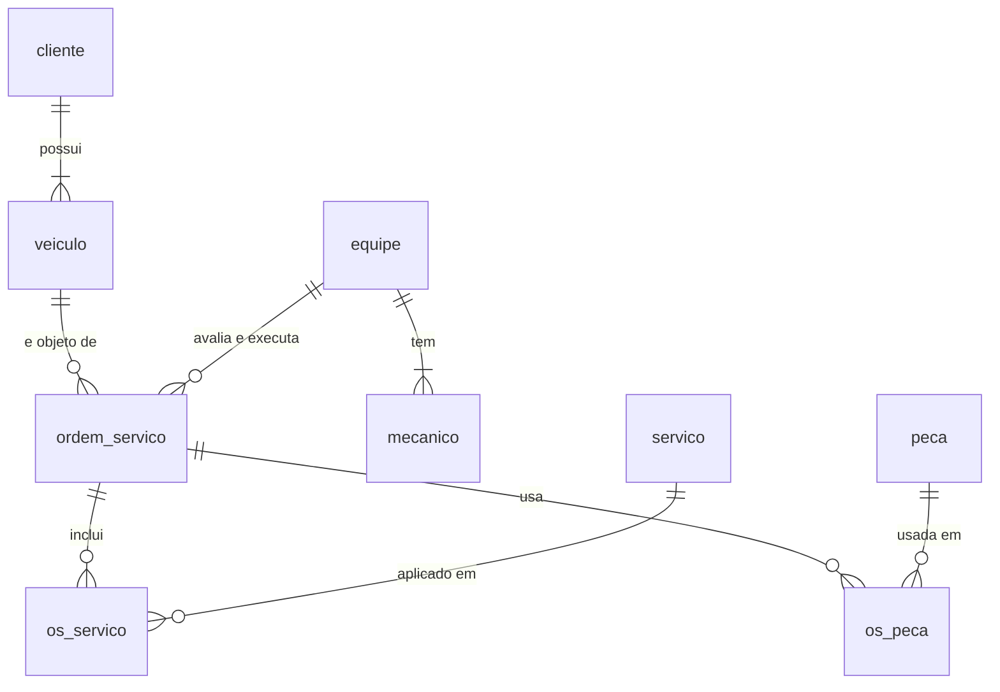

# Oficina mecânica: projeto lógico

Modelo relacional da oficina, mapeado a partir do [modelo conceitual](https://github.com/allanvjcavalcanti/oficina-modelo-conceitual). Inclui o script de criação, dados de teste e consultas.

Testado em MariaDB 10.11; deve rodar em MySQL 8.0.16 ou superior.

## Arquivos

- `01_schema.sql`: banco, tabelas, chaves, constraints e uma view
- `02_dados.sql`: dados de teste e cálculo do valor das OS
- `03_queries.sql`: 12 consultas

```bash
mysql -u root -p < 01_schema.sql
mysql -u root -p < 02_dados.sql
mysql -u root -p < 03_queries.sql
```

## Modelo



## Decisões de mapeamento

- A tabela de referência de mão de obra é a coluna `servico.valor_mao_obra`. Quando o serviço entra numa OS, o valor é copiado para `os_servico.valor_unitario`; o mesmo vale para as peças. Assim, um reajuste futuro não altera OS antigas.
- O valor da OS (mão de obra + peças) é calculado pela view `vw_os_valor` e gravado em `ordem_servico.valor` por um `update` no fim de `02_dados.sql`. Uma das consultas compara o valor gravado com o recalculado.
- A mesma equipe avalia e executa, então a OS tem um único `id_equipe`.
- A autorização do cliente fica em `autorizada` e `data_autorizacao`, com o status `Aguardando autorização` antes disso.
- A OS tem duas datas: `data_entrega_prevista` (preenchida na emissão, com `check` para não ser anterior a ela) e `data_conclusao` (preenchida quando termina).

## Consultas

Cobrem `where` (OS em aberto, mecânicos de motor), atributos derivados (dias de atraso, mão de obra + peças), `order by`, `having` (equipes com 2 ou mais OS, clientes com gasto acima de R$ 300, serviços repetidos, clientes com mais de um veículo) e junções (OS com cliente, veículo e equipe; mecânicos por equipe; serviços e peças de cada OS; OS aguardando autorização).

Exemplo, clientes que mais gastaram em OS concluídas:

```sql
select c.nome, count(*) as qtd_os, sum(os.valor) as total_gasto
from cliente c
join veiculo ve on ve.id_cliente = c.id_cliente
join ordem_servico os on os.id_veiculo = ve.id_veiculo
where os.status = 'Concluída'
group by c.id_cliente, c.nome
having sum(os.valor) > 300
order by total_gasto desc;
```

| nome | qtd_os | total_gasto |
|---|---|---|
| Roberto Almeida | 2 | 745.00 |
| Fernanda Costa | 1 | 620.00 |


