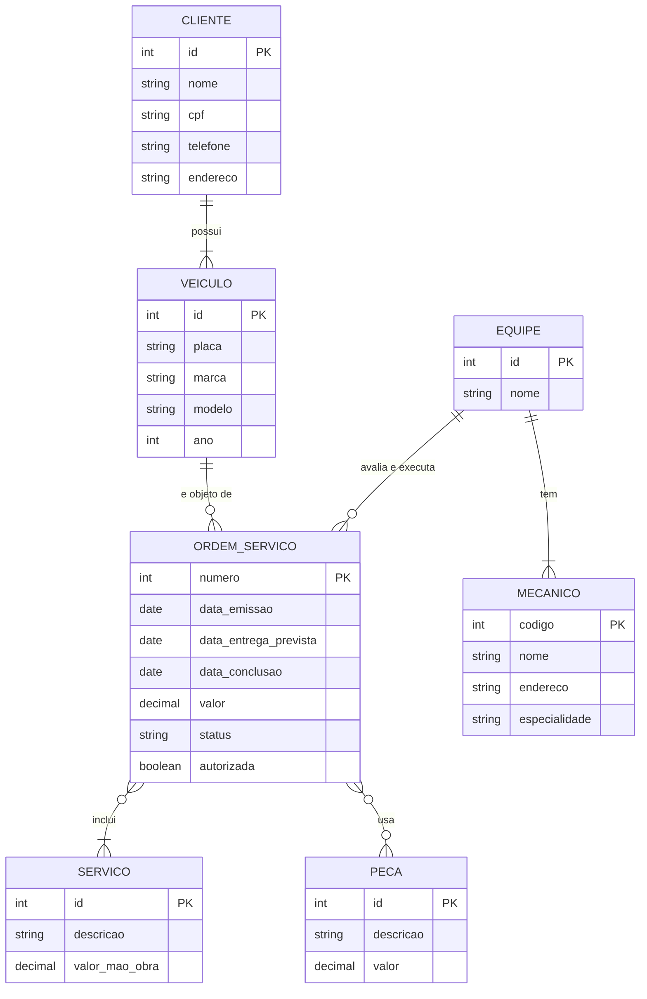

# Oficina mecânica: modelo conceitual

Modelo conceitual (ER) criado a partir da narrativa abaixo.

## Narrativa

- Sistema de controle e gerenciamento de execução de ordens de serviço em uma oficina mecânica.
- Clientes levam veículos à oficina para serem consertados ou para passarem por revisões periódicas.
- Cada veículo é designado a uma equipe de mecânicos que identifica os serviços a serem executados e preenche uma OS com data de entrega.
- A partir da OS, calcula-se o valor de cada serviço, consultando uma tabela de referência de mão de obra.
- O valor de cada peça também compõe a OS. O cliente autoriza a execução dos serviços.
- A mesma equipe avalia e executa os serviços.
- Os mecânicos possuem código, nome, endereço e especialidade.
- Cada OS possui número, data de emissão, valor, status e uma data para conclusão dos trabalhos.

## Diagrama

## Entidades

- **Cliente:** nome, CPF, telefone e endereço. Pode levar vários veículos.
- **Veículo:** placa, marca, modelo e ano. Pertence a um cliente e pode ter várias OS ao longo do tempo (conserto, revisões).
- **Equipe:** agrupa os mecânicos e é quem avalia e executa a OS.
- **Mecânico:** código, nome, endereço e especialidade. Pertence a uma equipe.
- **Ordem de serviço:** número, data de emissão, data de entrega prevista, data de conclusão, valor, status e se o cliente autorizou. O valor é derivado: soma dos serviços (pela tabela de referência de mão de obra) com as peças.
- **Serviço:** descrição e valor de mão de obra. Esse valor vem da tabela de referência.
- **Peça:** descrição e valor.

## Relacionamentos

| Relação | Cardinalidade |
|---|---|
| Cliente e veículo | 1:N |
| Veículo e OS | 1:N |
| Equipe e mecânico | 1:N |
| Equipe e OS | 1:N |
| OS e serviço | N:M (quantidade e valor aplicado) |
| OS e peça | N:M (quantidade e valor aplicado) |

## Suposições

A narrativa não define alguns pontos, então assumi:

- Cada mecânico pertence a uma única equipe, e a equipe é designada na OS.
- O valor da OS é gravado nela para manter o histórico, já que a tabela de referência pode mudar.
- O cliente autoriza depois de saber o valor, então a OS guarda a autorização e passa por um status de espera.
- Status da OS: em avaliação, aguardando autorização, autorizada, em execução, concluída ou cancelada.
- A "data para conclusão dos trabalhos" virou duas datas: a entrega prevista, preenchida na emissão, e a conclusão efetiva, preenchida quando o serviço termina.
- O cliente é identificado por CPF.

O modelo relacional e o script SQL estão no [projeto lógico](https://github.com/allanvjcavalcanti/oficina-projeto-logico-bd).
