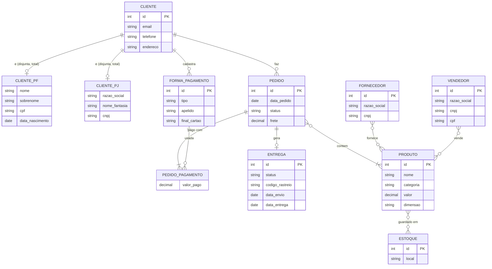

# E-commerce: modelo conceitual refinado

Modelo conceitual (EER) de um e-commerce com três refinamentos:

1. **Cliente PJ e PF.** Uma conta é PF ou PJ, nunca as duas. Modelei como uma especialização disjunta e total de `CLIENTE` em `CLIENTE_PF` e `CLIENTE_PJ`.
2. **Pagamento.** O cliente pode cadastrar mais de uma forma de pagamento, e um pedido pode ser pago com mais de uma delas.
3. **Entrega.** Tem status e código de rastreio.

## Diagrama

O Mermaid não tem símbolo de especialização, então ela aparece como uma relação "é" entre o supertipo e cada subtipo. A exclusividade (disjunta, total) está descrita mais abaixo.

## Entidades e regras

**Cliente** guarda o que é comum a qualquer conta (e-mail, telefone, endereço). O `CLIENTE_PF` acrescenta nome, sobrenome, CPF e data de nascimento; o `CLIENTE_PJ` acrescenta razão social, nome fantasia e CNPJ. Toda conta é de um dos dois tipos (total) e de apenas um (disjunta).

**Forma de pagamento** é o que o cliente cadastra: boleto, cartão de crédito, cartão de débito ou Pix. Um cliente pode ter várias. Guardo só os 4 últimos dígitos do cartão.

**Pedido** é feito por um cliente, tem data, status e frete, e contém um ou mais produtos com quantidade. Como pode ser pago com mais de uma forma (por exemplo, parte no cartão e parte no Pix), a relação com forma de pagamento é N:M, com o valor pago em cada uma.

**Entrega** nasce de um pedido e tem status e código de rastreio. O código só existe depois do envio.

**Produto, fornecedor, vendedor e estoque** seguem o modelo original: o fornecedor abastece produtos, o vendedor terceiro os vende e o estoque guarda a quantidade de cada produto por local.

## Cardinalidades

| Relação | Cardinalidade |
|---|---|
| Cliente e pedido | 1:N |
| Cliente e forma de pagamento | 1:N |
| Pedido e forma de pagamento | N:M (com `valor_pago`) |
| Pedido e entrega | 1:0..1 (pedido cancelado não tem entrega) |
| Pedido e produto | N:M (com quantidade e valor unitário) |
| Fornecedor e produto | N:M |
| Vendedor e produto | N:M |
| Produto e estoque | N:M (com quantidade) |

## Suposições

O enunciado não definia alguns pontos, então assumi:

- Um pedido tem no máximo uma entrega.
- O status da entrega segue: aguardando envio, em transporte, saiu para entrega, entregue (ou devolvido).
- O vendedor terceiro pode ser pessoa física (CPF) ou jurídica (CNPJ).
- O mesmo CNPJ pode aparecer como vendedor e como fornecedor, e é por aí que se descobre se um vendedor também é fornecedor.

O mapeamento para o modelo relacional e o script SQL estão no [projeto lógico](https://github.com/allanvjcavalcanti/ecommerce-projeto-logico-bd).

